# Feature dimensionality reduction! PCA, KPCA principal component analysis, contribution calculation, feature dimensionality reduction, scatter plots, from beginner to mastery, Matlab program

Applicable Platform: Matlab2021 and above
What is Data Dimensionality Reduction?
Data dimensionality reduction refers to mapping high-dimensional data into a lower-dimensional space while preserving important information within the data. This operation can help us better understand and process data, reduce computational complexity, and enhance the efficiency and accuracy of machine learning algorithms.

Dimensionality Reduction Methods: PCA and KPCA are both dimensionality reduction techniques used to extract main features from high-dimensional data or perform nonlinear dimensionality reduction. Below, we will detail their principles and differences (with accompanying program results).
Principal Component Analysis (PCA)
PCA is a dimensionality reduction technique that aims to generate new features from given features, not just selecting existing ones. These new features, known as principal components, are linear combinations of the original features. By projecting the data onto directions with maximum variance, PCA achieves dimensionality reduction.
In PCA, the principal components are ordered by the variance they capture. Selecting the first few principal components allows for dimensionality reduction, as these components contain most of the variance information in the original data. By discarding components with smaller variance, we can reduce the data while preserving as much of the original information as possible.

Calculation Steps:
Centering the Data: First, perform a centered operation on the data, which does not alter the layout of the original samples. This involves subtracting the mean of each feature from its corresponding mean, resulting in zero mean for the data, which helps eliminate the impact of translations in the original data.
Covariance Matrix: The core idea of PCA is to find the principal components through computing the covariance matrix, which represents the direction of maximum variance in the data.
Feature values and eigenvectors: The covariance matrix is decomposed into its eigenvalues and eigenvectors. The eigenvectors form the principal components, while the eigenvalues represent the variance along these principal directions.
Dimensionality reduction: By selecting the eigenvectors with larger eigenvalues, corresponding dimensions are identified as principal components. This allows data to be projected onto these principal components, achieving dimensionality reduction.
Characteristics:
Linear dimensionality reduction: PCA is a linear dimensionality reduction method that can only capture the linear structure in data.
Globality: PCA selects principal components based on the overall variance, which may not well capture local non-linear structures.
Kernel principal component analysis (KPCA)
PCA is linear, and for data containing nonlinear structures, it may perform poorly. KPCA introduces kernel techniques, which allow nonlinear mapping in high-dimensional space without explicitly computing the data points in the high-dimensional space. The basic idea of kernel techniques is to calculate the similarity between points in the original feature space using a kernel function (such as polynomial kernel or Gaussian kernel), and then use these similarities to perform PCA in the high-dimensional space.
Calculation steps:
Nonlinear mapping: Through kernel techniques, KPCA maps the original data to a high-dimensional feature space, making the nonlinear structure of the data linearly separable in this space. This enables performing PCA in the high-dimensional space.
Principal component extraction: In the high-dimensional space, KPCA completes dimensionality reduction by finding the principal components in the data. These principal components correspond to the direction of maximum variance in the high-dimensional space.
Dimensionality Reduction: KPCA maps data to a high-dimensional space, then selects the most important principal components to achieve dimensionality reduction in the original data space. This helps preserve the nonlinear structure of the data.

Features:
Nonlinear Mapping: KPCA can handle data containing nonlinear structures, enabling linear analysis in the high-dimensional space. This is particularly useful for practical problems such as image recognition and pattern recognition.
Preservation of Nonlinear Structure: Compared to traditional PCA, KPCA is better at preserving the nonlinear structure of the data, typically providing better performance when dealing with nonlinear issues.
Kernel Function Choice: The performance of KPCA largely depends on the choice of kernel function. Different kernel functions are suitable for different types of data, so careful selection of appropriate kernel functions is necessary when applying KPCA.
Computational Complexity: Due to the computations in the high-dimensional space, KPCA has relatively higher computational complexity. This can be a challenge when processing large-scale datasets.

Summary: If the data have a clear linear structure, PCA may be sufficient. However, if the data contain complex nonlinear structures or need to better capture local information, KPCA might be more suitable.

PCA after dimensionality reduction
KPCA after dimensionality reduction
The table has been written into Excel for easy reference by everyone.

## Images

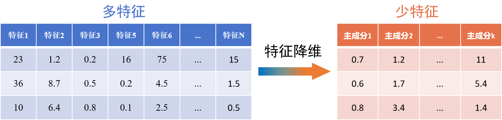
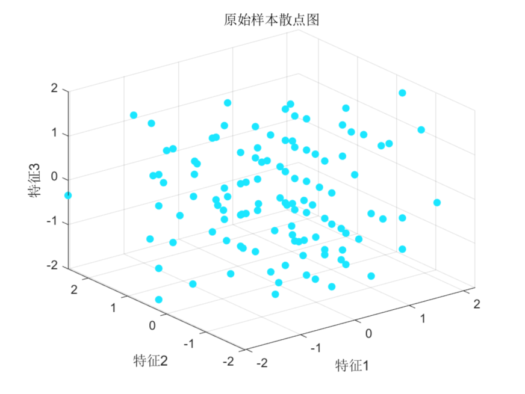
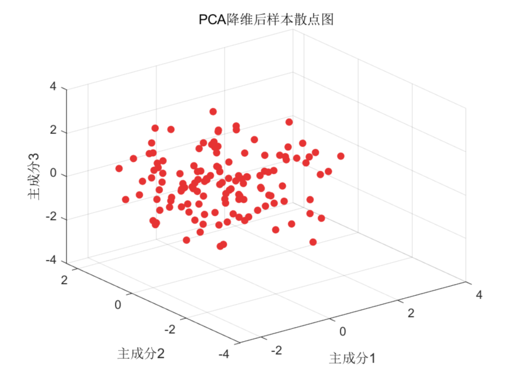
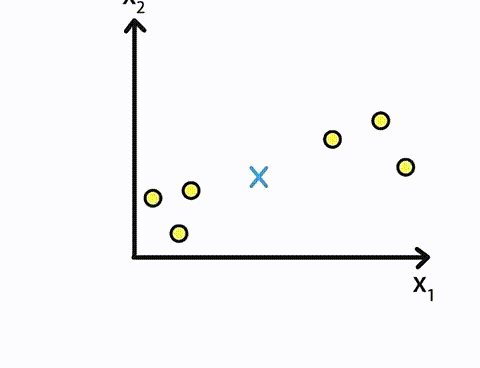
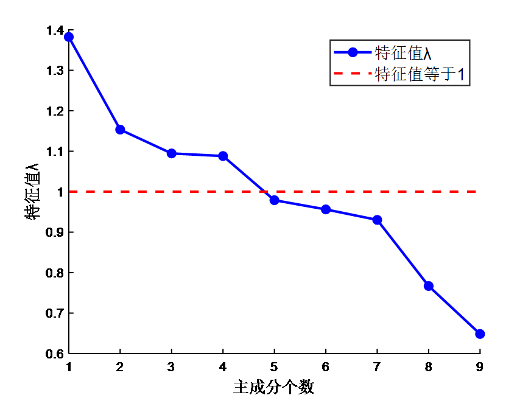
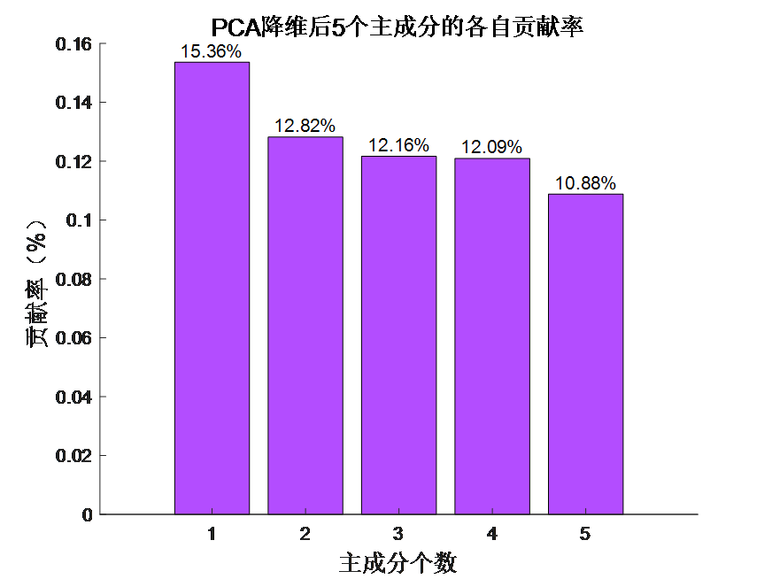
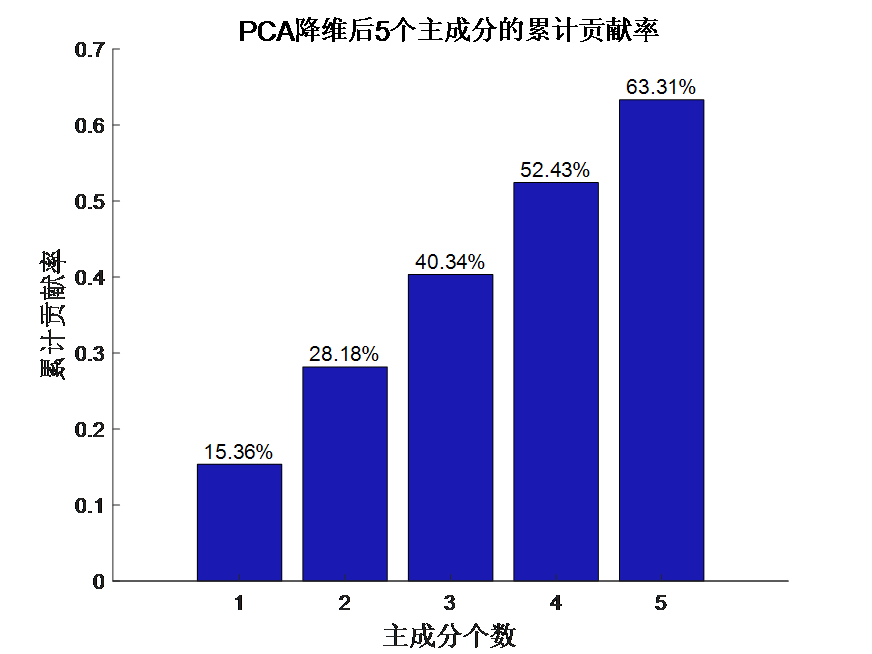
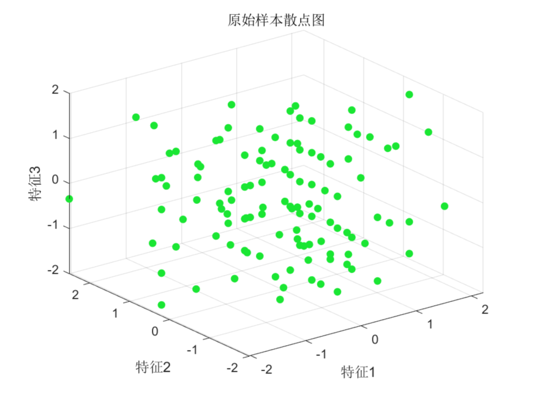
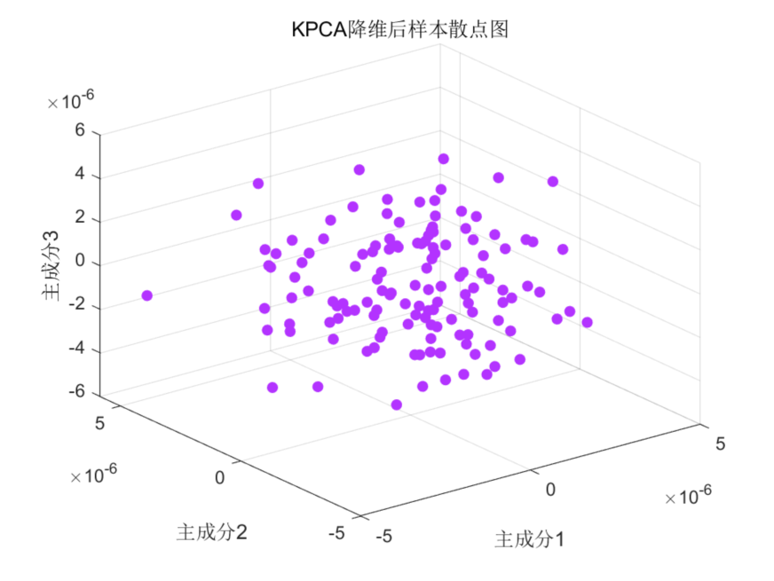
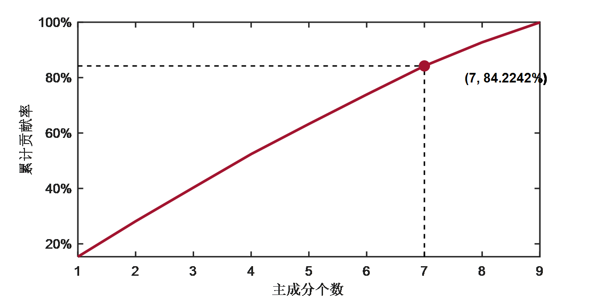
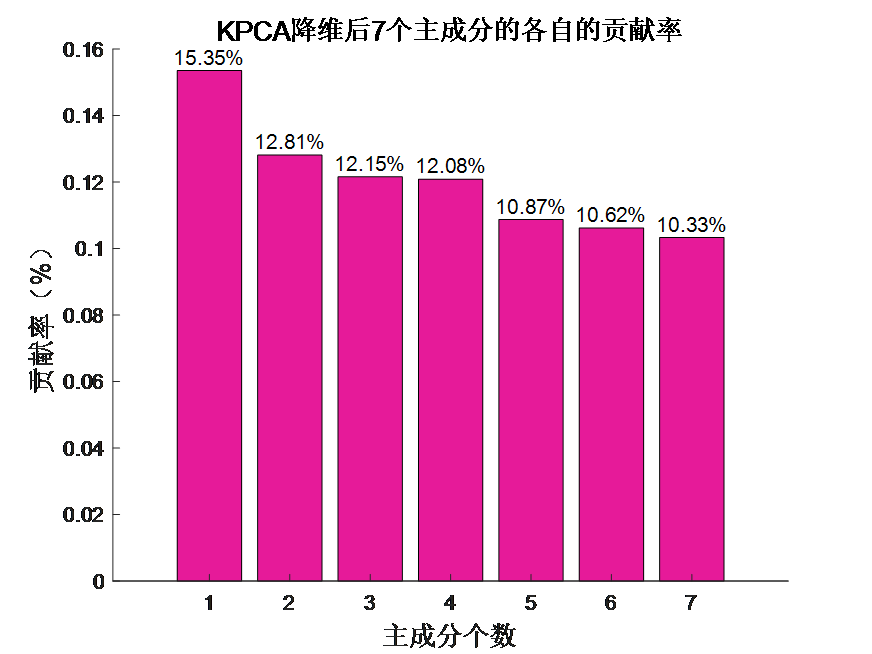
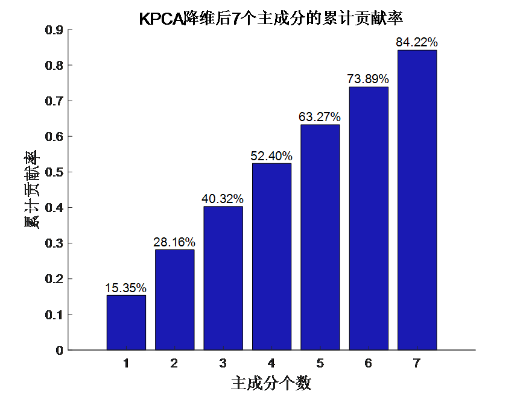

<!-- PAYMENT_BLOCK -->

## Get this dataset

- Payment link (Stripe): [Buy now](https://buy.stripe.com/3cs8yP7sY87d0vu9AB)
- Payment QR code: 

<!-- /PAYMENT_BLOCK -->
